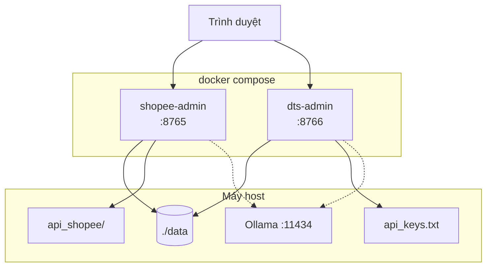
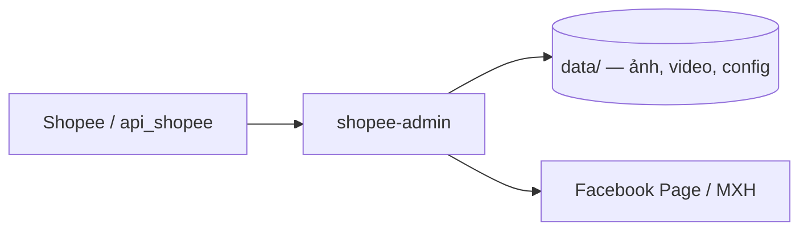
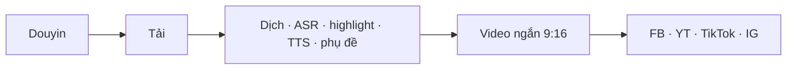

# Shopee Auto Post — hai hệ thống admin

Repo này chạy **hai trang quản trị web** qua Docker Compose (`docker-compose.yml`):

| Hệ thống | Container / image | Cổng | Nguồn → đích |
|---|---|---|---|
| **shopee-admin** | `shopee-admin` (service `admin`) | **8765** | Shopee → ảnh/video → Facebook / MXH |
| **dts-admin** | `dts-admin` (service `dts`) | **8766** | Douyin → video ngắn thuyết minh VI → Facebook · YouTube · TikTok · Instagram |

Cả hai dùng `network_mode: host` (gọi Ollama / dịch vụ trên máy host qua `127.0.0.1`) và chia sẻ thư mục dữ liệu `./data`.

> Chỉ dùng nội dung bạn có quyền. Tự động hóa Shopee / Douyin / MXH có rủi ro tài khoản — nên dùng tài khoản phụ, không chạy dồn dập.



---

## shopee-admin (cổng 8765)

Trang quản trị **Shopee → mạng xã hội**: lấy sản phẩm / media từ Shopee (curl mẫu trong `api_shopee/`), theo dõi file ảnh·video trong workspace, đăng lên Facebook Page (và luồng social liên quan), có đăng nhập admin.

- UI: `shopeetool/web/` · backend: `shopeetool/admin_web.py`
- Image build từ `Dockerfile` (Python + Playwright Chromium)
- Mount: `./data`, `./shopeetool/web` (ro), `./api_shopee` (ro)
- Mật khẩu lần đầu: biến `SHOPEE_ADMIN_PASSWORD` (trống = `admin123` — đổi ngay sau khi đăng nhập)
- LLM tuỳ chọn: `OLLAMA_URL=http://127.0.0.1:11434/api/chat`



Mở: http://127.0.0.1:8765

---

## dts-admin (cổng 8766)

Trang quản trị **Douyin → video ngắn → đa nền tảng**: tải video Douyin, dịch / ASR, chọn highlight, lồng tiếng VI + phụ đề, xuất short ~9:16, rồi đăng Facebook · YouTube Shorts · TikTok · Instagram Reels.

- UI + pipeline: `douyin_to_social_media/` · entry: `admin_web.py`
- Image build từ `douyin_to_social_media/Dockerfile` (Python + ffmpeg)
- Mount: `./data`, toàn bộ `./douyin_to_social_media`, `./api_keys.txt` (ro)
- LLM tuỳ chọn: `OLLAMA_URL=http://127.0.0.1:11434/api/generate`
- Key cloud (Gemini / Groq / FPT…): file `api_keys.txt` ở thư mục gốc



Pipeline chi tiết, công thức biên tập và setup từng nền tảng: [douyin_to_social_media/README.md](douyin_to_social_media/README.md).

Mở: http://127.0.0.1:8766

---

## Cấu trúc thư mục (phần chính)

```
shopee_auto_post/
├── docker-compose.yml          # service admin + dts
├── Dockerfile                  # image shopee-admin
├── api_keys.txt                # key LLM/TTS cho dts (không commit khóa thật)
├── api_shopee/                 # curl mẫu Shopee (mount vào shopee-admin)
├── data/                       # dữ liệu runtime (gitignore) — dùng chung 2 container
├── shopeetool/
│   ├── admin_web.py            # backend shopee-admin
│   ├── web/                    # UI build sẵn (mount ro)
│   ├── admin-ui/               # mã nguồn UI (dev)
│   └── …                       # facebook, shopee, auth, jobs…
└── douyin_to_social_media/
    ├── Dockerfile              # image dts-admin
    ├── admin_web.py            # backend dts-admin
    ├── douyin_*.py             # pipeline AI video
    ├── publishers/             # YouTube / TikTok / Instagram
    ├── data/douyin/            # manifest, video, processed…
    └── docs/                   # hướng dẫn DTS
```

| Đường dẫn | Nội dung |
|---|---|
| `data/` | Config, media, log, workspace người dùng (shopee-admin) |
| `douyin_to_social_media/data/douyin/` | Manifest, video gốc, `processed/`, lịch sử đăng (dts-admin) |
| `api_keys.txt` | `gemini_api_key`, `groq_api_key`, `fpt_api_key`, … |

---

## Cài đặt Docker

### Windows

1. Cài [Docker Desktop](https://docs.docker.com/desktop/setup/install/windows-install/) (bật WSL 2).
2. Mở Docker Desktop → trạng thái *Running*.
3. PowerShell / CMD tại thư mục dự án.

> `network_mode: host` trên Docker Desktop đi qua WSL 2. Nếu container không gọi được Ollama trên Windows host, chạy Ollama trong WSL hoặc chỉnh `OLLAMA_URL`.

### Ubuntu

```bash
sudo apt-get update
sudo apt-get install -y docker.io docker-compose-v2
sudo systemctl enable --now docker
sudo usermod -aG docker "$USER"
# Đăng xuất / đăng nhập lại
docker version && docker compose version
```

Hoặc theo [Docker Engine — Ubuntu](https://docs.docker.com/engine/install/ubuntu/).

---

## Build và chạy

### Chuẩn bị

```bash
cd /đường/dẫn/shopee_auto_post
mkdir -p data
```

- Có sẵn `api_shopee/` (shopee-admin).
- Có `api_keys.txt` ở gốc (dts-admin).
- (Tuỳ chọn) [Ollama](https://ollama.com/) trên host cổng `11434`.
- (Tuỳ chọn) mật khẩu admin Shopee:

```bash
# bash
export SHOPEE_ADMIN_PASSWORD='mat-khau-manh'

# PowerShell
$env:SHOPEE_ADMIN_PASSWORD = 'mat-khau-manh'
```

### Cả hai hệ thống

```bash
docker compose up -d --build
docker compose ps
```

Lần đầu build có thể lâu (Playwright/Chromium cho shopee-admin; ffmpeg + pip cho dts-admin).

| Hệ thống | URL |
|---|---|
| shopee-admin | http://127.0.0.1:8765 |
| dts-admin | http://127.0.0.1:8766 |

### Chỉ một hệ thống

```bash
docker compose up -d --build admin   # shopee-admin :8765
docker compose up -d --build dts     # dts-admin :8766
```

### Log / cập nhật / dừng

```bash
docker compose logs -f admin
docker compose logs -f dts
docker compose up -d --build         # rebuild khi đổi Dockerfile / requirements
docker compose restart admin dts
docker compose down                  # giữ ./data trên host
```

Sửa UI/pipeline trên host (volume mount) thường **không cần rebuild**; chỉ rebuild khi đổi `Dockerfile` hoặc dependency cài trong image.

### Biến môi trường

| Biến | Service | Mặc định | Ý nghĩa |
|---|---|---|---|
| `SHOPEE_ADMIN_PASSWORD` | `admin` | trống → `admin123` | Mật khẩu admin lần đầu |
| `OLLAMA_URL` | `admin` | `http://127.0.0.1:11434/api/chat` | LLM shopee-admin |
| `DTS_HOST` / `DTS_PORT` | `dts` | `0.0.0.0` / `8766` | Bind dts-admin |
| `OLLAMA_URL` | `dts` | `http://127.0.0.1:11434/api/generate` | LLM fallback pipeline DTS |

---

## Chạy không Docker (dev)

```bash
# shopee-admin
.venv/bin/python -m shopeetool.admin_web
# → http://127.0.0.1:8765

# dts-admin
.venv/bin/python douyin_to_social_media/admin_web.py
# → http://127.0.0.1:8766
```

---

## Bảo mật

- **Không commit** `data/`, khóa trong `api_keys.txt`, cookie Shopee/Douyin, Page token.
- Đổi mật khẩu shopee-admin ngay nếu dùng mặc định `admin123`.
- Không chia sẻ URL Web app / App Secret / token ra ngoài.

---

## Tài liệu thêm

| Chủ đề | File |
|---|---|
| Pipeline Douyin & MXH | [douyin_to_social_media/README.md](douyin_to_social_media/README.md) |
| Công thức short thuyết minh | [douyin_to_social_media/docs/CONG_THUC_SHORTS_THUYET_MINH.md](douyin_to_social_media/docs/CONG_THUC_SHORTS_THUYET_MINH.md) |
| YouTube / TikTok / Instagram | `douyin_to_social_media/docs/*_SETUP.md` |
| App desktop Tkinter / Sheet / CLI (cũ) | [docs/HUONG_DAN_SU_DUNG.md](docs/HUONG_DAN_SU_DUNG.md), [docs/HUONG_DAN_KET_NOI.md](docs/HUONG_DAN_KET_NOI.md), [docs/HUONG_DAN_COMMAND.md](docs/HUONG_DAN_COMMAND.md), [docs/HUONG_DAN_UBUNTU.md](docs/HUONG_DAN_UBUNTU.md) |

App desktop (`app.py`, Google Sheet, PyInstaller) vẫn nằm trong repo nhưng **không còn là lối vào chính** — vận hành hàng ngày dùng hai admin web ở trên.
