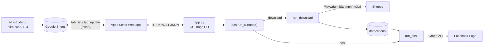
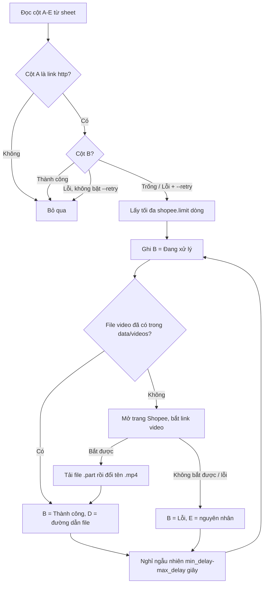
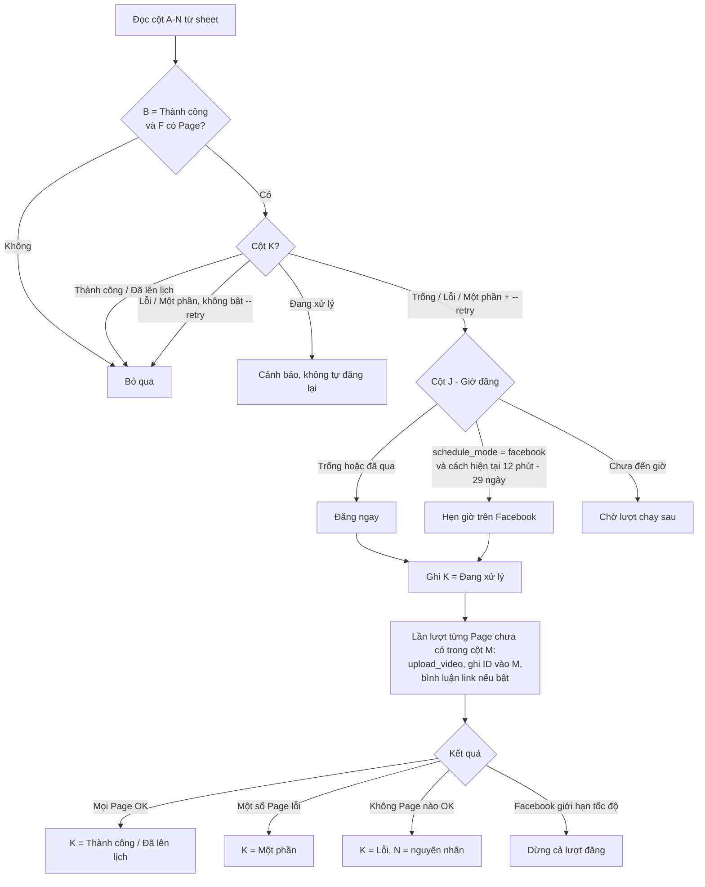

# Shopee Auto Post (Shopee → Facebook Tool)

Ứng dụng cho **Windows và Ubuntu** (giao diện Tkinter + dòng lệnh, dùng chung một mã nguồn) tự động **tải video sản phẩm Shopee** theo danh sách link trong **Google Sheet**, sau đó **đăng video lên một hoặc nhiều Facebook Page** (đăng ngay hoặc hẹn giờ) và **ghi trạng thái vào lại sheet**.

> Chỉ dùng cho video bạn có quyền sử dụng (video của bạn, hoặc shop/chủ video đã đồng ý). Tự động hóa trên Shopee/Facebook có rủi ro với tài khoản, nên dùng tài khoản phụ và không chạy dồn dập.

## Tính năng

- Mở trình duyệt thật (Edge/Chrome qua Playwright), bắt link video `.mp4` / `.m3u8` rồi tải về (ghi ra file `.part`, tải xong mới đổi tên).
- Đọc/ghi Google Sheet qua **Google Apps Script Web app** (miễn phí, không cần Google Cloud).
- Đăng video lên nhiều Facebook Page bằng **Graph API**: đăng ngay hoặc hẹn giờ, link affiliate + hashtag, tùy chọn đưa link vào bình luận đầu tiên, chạy lại dòng lỗi / đăng nốt Page chưa thành công, chống đăng trùng, tự dừng khi Facebook giới hạn tốc độ.
- Chế độ: chỉ tải, chỉ đăng, tải rồi đăng, tải và đăng song song; tự chạy lại mỗi N phút; chạy thử (dry-run).
- Nhật ký tự che token/URL bí mật.

## Luồng hoạt động

### Tổng quan



Các chế độ của `run_all`:

| Chế độ | Luồng |
|---|---|
| `download` | Chỉ chạy `run_download` |
| `post` | Chỉ chạy `run_post` |
| `download_post` | `run_download` xong rồi mới `run_post` |
| `parallel` | `run_download` chạy ở luồng riêng, `run_post` lặp lại mỗi 60 giây để đăng các dòng vừa tải xong, cuối cùng chạy `run_post` thêm một lượt |

### Tải video (`run_download`)



### Đăng Facebook (`run_post`)



Cột M lưu ID bài theo từng Page (`Tên Page [PAGE_ID] :: ID_BÀI`), nên khi chạy lại với `--retry` chương trình chỉ đăng nốt các Page còn thiếu, không đăng trùng.

## Cấu trúc thư mục

```
shopee_auto_post/
├── app.py                  # Điểm vào: không tham số = giao diện; `app.py cli <lệnh>` = dòng lệnh
├── shopeetool/
│   ├── __init__.py         # VERSION, APP_TITLE (phiên bản chỉ khai báo ở đây)
│   ├── platforms.py        # MỌI khác biệt Windows/Ubuntu: thư mục dữ liệu, trình duyệt, ffmpeg, font...
│   ├── config.py           # Đọc/ghi data/config.json, giá trị mặc định
│   ├── paths.py            # Thư mục chương trình / dữ liệu / tài nguyên
│   ├── logger.py           # RunContext: nhật ký, thống kê, hủy giữa chừng
│   ├── sheet.py            # SheetClient gọi Apps Script
│   ├── appscript.py        # Mã Google Apps Script (chèn token khi sao chép)
│   ├── shopee.py           # Đăng nhập, bắt link video, tải video
│   ├── facebook.py         # Graph API: token, Page, đăng video, bình luận
│   ├── jobs.py             # Nghiệp vụ: run_download, run_post, run_all
│   ├── cli.py              # Lệnh dòng lệnh
│   ├── gui.py, mdview.py   # Giao diện
│   └── syscheck.py         # Kiểm tra môi trường
├── tests/
│   ├── test_core.py        # Test logic lõi với Sheet/Facebook giả (không cần mạng)
│   └── gui_smoke.py        # Test giao diện (Linux + Xvfb)
├── scripts/
│   ├── build.py            # Logic đóng gói PyInstaller dùng chung cho 2 hệ điều hành
│   ├── windows/            # chay_ung_dung.bat, build_exe.bat
│   └── ubuntu/             # setup.sh, chay_ung_dung.sh, build.sh
├── docs/                   # Hướng dẫn sử dụng (hiển thị cả trong tab "Hướng dẫn")
├── requirements.txt        # Thư viện khi chạy (pyproject.toml đọc từ file này)
└── pyproject.toml          # Metadata, thư viện dev, cấu hình ruff
```

Dữ liệu khi chạy nằm trong `data/` cạnh `app.py` (nếu không ghi được thì dùng `%LOCALAPPDATA%\ShopeeFBTool` trên Windows, `~/.local/share/ShopeeFBTool` trên Ubuntu), đã được `.gitignore` loại bỏ:

| File / thư mục | Nội dung |
|---|---|
| `data/config.json` | Cấu hình, **token Apps Script, App Secret, Page token** |
| `data/shopee_state.json` | Cookie phiên đăng nhập Shopee |
| `data/videos/` | Video đã tải |
| `data/logs/` | Nhật ký theo ngày |

## Windows

| Việc | Cách làm |
|---|---|
| Chạy từ mã nguồn | Bấm đúp `scripts\windows\chay_ung_dung.bat` (lần đầu tự cài thư viện) |
| Đóng gói | Bấm đúp `scripts\windows\build_exe.bat` → `dist\ShopeeFBTool\ShopeeFBTool.exe` và `dist\ShopeeFBTool-<phiên bản>-windows.zip` |
| Máy đích | Windows 10/11, có Microsoft Edge (có sẵn) hoặc Google Chrome |

## Ubuntu

| Việc | Cách làm |
|---|---|
| Cài lần đầu | `./scripts/ubuntu/setup.sh` (apt + `.venv` + Chromium của Playwright, cần sudo) |
| Chạy từ mã nguồn | `./scripts/ubuntu/chay_ung_dung.sh` (giao diện) hoặc `./scripts/ubuntu/chay_ung_dung.sh cli <lệnh>` |
| Đóng gói | `./scripts/ubuntu/build.sh` → `dist/ShopeeFBTool/ShopeeFBTool` và `dist/ShopeeFBTool-<phiên bản>-ubuntu.tar.gz` |
| Máy đích | Ubuntu 22.04/24.04, có Google Chrome (gói .deb) |

Chi tiết (cron, xvfb, lỗi thường gặp): [HUONG_DAN_UBUNTU.md](docs/HUONG_DAN_UBUNTU.md).

Hướng dẫn chung: [HUONG_DAN_SU_DUNG.md](docs/HUONG_DAN_SU_DUNG.md), [HUONG_DAN_KET_NOI.md](docs/HUONG_DAN_KET_NOI.md), [HUONG_DAN_COMMAND.md](docs/HUONG_DAN_COMMAND.md).

## Phát triển

Yêu cầu: Python 3.10+, [ffmpeg](https://ffmpeg.org/download.html) (chỉ cần cho video `.m3u8`).

```bash
# Windows                              # Ubuntu
py -m venv .venv                       ./scripts/ubuntu/setup.sh
.venv\Scripts\activate                 source .venv/bin/activate
pip install -e ".[dev]"                pip install -e ".[dev]"
pre-commit install                     pre-commit install
```

Chạy (sau khi activate `.venv`):

```bash
python app.py                 # giao diện
python app.py cli             # danh sách lệnh
python app.py cli check       # kiểm tra môi trường
python app.py cli post --dry-run
```

Kiểm tra trước khi commit:

```bash
ruff check .
python tests/test_core.py
```

Quy ước:
- Phiên bản chỉ sửa ở `shopeetool/__init__.py` (`VERSION`); `pyproject.toml` tự đọc.
- Thêm thư viện chạy vào `requirements.txt`; thư viện chỉ dùng khi phát triển vào `[project.optional-dependencies].dev` trong `pyproject.toml`.
- Code khác nhau giữa Windows và Ubuntu chỉ đặt trong `shopeetool/platforms.py`; module khác không tự kiểm tra `os.name`.
- Script riêng từng hệ điều hành nằm ở `scripts/windows/` (CRLF) và `scripts/ubuntu/` (LF, có quyền thực thi); logic đóng gói chung ở `scripts/build.py`.
- Không commit file nhị phân (`.zip`, `.exe`, `.tar.gz`, video). Bản đóng gói build bằng script trong `scripts/`.
- Mã Apps Script nằm trong `shopeetool/appscript.py`; sửa xong cần triển khai **phiên bản mới** của Web app.

## Cấu trúc Google Sheet (tab đầu tiên)

| Cột | Nội dung | Ai điền |
|---|---|---|
| A | Link sản phẩm Shopee | Bạn |
| B-E | Trạng thái tải, Thời gian, File video, Ghi chú | Chương trình |
| F | Page (tên hoặc ID; nhiều Page ngăn cách bằng dấu phẩy/xuống dòng) | Bạn |
| G | Link affiliate (trống thì dùng link cột A) | Bạn |
| H | Nội dung bài đăng | Bạn |
| I | Tag, ví dụ `#giadung #sale` hoặc `giadung, sale` | Bạn |
| J | Giờ đăng, ví dụ `04/10/2026 09:00` (trống = đăng ngay) | Bạn |
| K-N | Trạng thái đăng, Đã xử lý lúc, ID bài đăng, Ghi chú đăng | Chương trình |

Chỉ dòng có cột B = `Thành công` (đã tải xong) và đã điền cột F mới được đăng.

## Trạng thái trong sheet

| Trạng thái | Ý nghĩa | Cách xử lý |
|---|---|---|
| Thành công (cột B) | Đã tải video | Điền cột F-J để đăng |
| Lỗi (cột B) | Không tải được, xem cột E | Sửa nguyên nhân, chạy với `--retry` |
| Thành công (cột K) | Đã đăng lên mọi Page | Không cần làm gì |
| Đã lên lịch | Facebook sẽ tự đăng đúng giờ | Không cần làm gì |
| Một phần | Một số Page đã lên, một số lỗi | Chạy `--retry` để đăng nốt, không đăng trùng |
| Lỗi (cột K) | Không đăng được, xem cột N | Sửa nguyên nhân rồi chạy lại |
| Đang xử lý | Bị dừng giữa chừng | Kiểm tra trên Facebook; nếu chưa có bài thì xóa ô đó để chạy lại |

## Chuyển từ bản script cũ (thư mục `Shopee/`)

Các script lẻ (`shopee_fb_post.py`, `shopee_batch_appsscript.py`, ...) đã được thay bằng `app.py cli ...`, bảng đối chiếu lệnh ở mục 6 của [HUONG_DAN_COMMAND.md](docs/HUONG_DAN_COMMAND.md). Bản `shopee_batch_gsheet.py` (gspread + Service Account) không còn được hỗ trợ. Mã cũ vẫn xem được trong lịch sử git (commit `319d0ad`).

Dữ liệu cũ trong `Shopee/` không được dùng nữa: nạp lại Page bằng `py app.py cli sync-pages TOKEN_DAI_HAN` (hoặc nút "Lấy Page" trong giao diện) và đăng nhập Shopee lại bằng `py app.py cli login-shopee`.

## Bảo mật

- **Không commit** thư mục `data/` (đã có trong `.gitignore`); `pre-commit` chặn file lớn và khóa riêng tư.
- Không chia sẻ Web app URL, token Apps Script, App Secret và Page token.
- `py app.py cli config show` che sẵn các giá trị bí mật khi cần gửi cấu hình để hỗ trợ.
