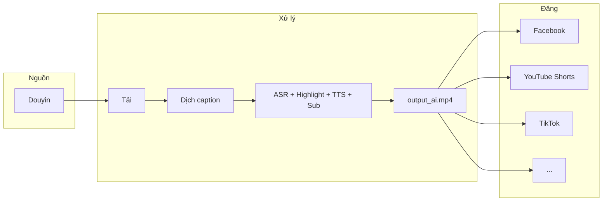

# Định hướng hệ thống — douyin_to_social_media

> Cập nhật: 2026-10-21  
> Đổi tên từ `youtube_to_facebook` → `douyin_to_social_media`

---

## 1. Tuyên bố sản phẩm

**Một câu:** lấy nội dung hay từ Douyin → biến thành Shorts thuyết minh tiếng Việt → đăng đa nền tảng.

| Trục | Quyết định |
|------|------------|
| Nguồn chính | **Douyin** (user / video đơn) |
| Đầu ra | Video ngắn **9:16**, mục tiêu **~150s**, hard cap **≤180s** |
| Ngôn ngữ | Thuyết minh + phụ đề **tiếng Việt** |
| Đích đăng | Facebook · YouTube · TikTok · Instagram (mỗi tab / hàng đăng riêng) |
| Không làm | Coi YouTube làm nguồn sản xuất chính; đăng một nền rồi dừng |

---

## 2. Luồng end-to-end



Chi tiết bước AI: [`PLAN_DOUYIN_AI_VIDEO.md`](./PLAN_DOUYIN_AI_VIDEO.md)  
Công thức lời/hình: [`CONG_THUC_SHORTS_THUYET_MINH.md`](./CONG_THUC_SHORTS_THUYET_MINH.md)

---

## 3. Nguyên tắc thiết kế

1. **Douyin-first** — mọi API `/api/douyin/*`, kho `data/douyin/`, UI mặc định Douyin.
2. **Một file xuất, nhiều publisher** — `*_ai.mp4` (hoặc bản gốc đã duyệt) là artifact chung; mỗi nền tảng chỉ khác metadata / API upload.
3. **Publisher pluggable** — interface chung (`publish(video_id, platform) → result`); Facebook là implementation đầu tiên.
4. **CPU-first** — máy hiện tại không có GPU hiện đại; ASR/TTS phải chạy tuần tự, model nhẹ.
5. **Legacy tách biệt** — kho YouTube cũ không trộn vào `data/douyin/`; giữ để tham chiếu công thức / affiliate.

---

## 4. Nền tảng đích (roadmap)

| Nền tảng | Module | Ưu tiên | Ghi chú |
|----------|--------|---------|---------|
| Facebook Page | `douyin_poster.py` / `publishers/facebook.py` | P0 ✅ | Graph API upload video |
| YouTube Shorts | `publishers/youtube.py` | P1 | YouTube Data API v3 + OAuth |
| TikTok | `publishers/tiktok.py` | P1 | Content Posting API |
| Instagram Reels | sau | P2 | Meta Graph (cùng hệ FB) |
| Threads / X | sau | P3 | Khi có nhu cầu |

Cấu hình đích đăng dự kiến trong `data/douyin/config.json`:

```json
{
  "platforms": {
    "facebook": { "enabled": true, "page_id": "...", "token": "..." },
    "youtube": { "enabled": false, "channel_id": "", "credentials": "" },
    "tiktok": { "enabled": false, "open_id": "", "credentials": "" }
  },
  "auto": {
    "enabled": false,
    "interval_minutes": 60,
    "order": "oldest",
    "targets": ["facebook"]
  }
}
```

---

## 5. Ranh giới với monorepo `shopee_auto_post`

| Thành phần | Vai trò |
|------------|---------|
| `douyin_to_social_media/` | Sản xuất & phân phối nội dung short-form |
| `shopeetool/` | Công cụ Shopee / Facebook dùng chung (upload FB, …) |
| `app.py` / admin Shopee | Affiliate / quản trị shop — tách khỏi pipeline Douyin |

---

## 6. Việc đã / sẽ làm sau rename

- [x] Đổi tên thư mục + Docker service `dts`
- [x] README + tài liệu định hướng
- [x] UI tab đích: Facebook / YouTube / TikTok / Instagram
- [x] Xóa kho video YouTube legacy
- [x] YouTube / TikTok / Instagram publishers + hàng posts riêng
- [ ] Gộp UI chọn nhiều đích trong một lần đăng (sau)
