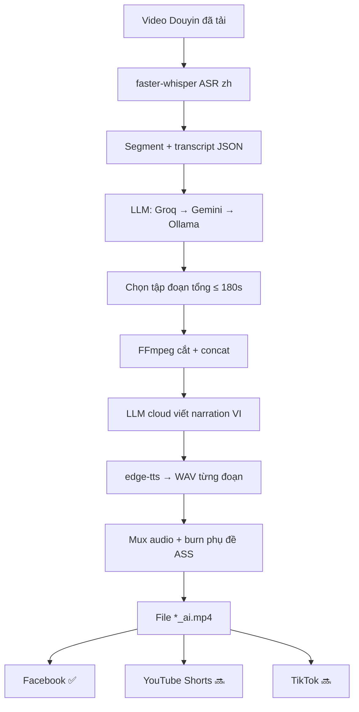

# Plan: Douyin → Video AI (cắt ≤2 phút + lồng tiếng + phụ đề)

> Cập nhật: 2026-10-20  
> Máy phân tích: `larryvu-pc` (Ubuntu 24.04.4 LTS)  
> Phạm vi: pipeline `douyin_to_social_media` (Douyin → video ngắn AI → đăng đa nền tảng; FB đã có)  
> **Công thức biên tập/thuyết minh (áp dụng nhiều video):** [`CONG_THUC_SHORTS_THUYET_MINH.md`](./CONG_THUC_SHORTS_THUYET_MINH.md) — nguồn chuẩn Shorts `cnJblXj7EUk`

---

## 1. Phân tích cấu hình server

| Thành phần | Thực tế trên máy | Đánh giá cho AI video |
|------------|------------------|------------------------|
| **CPU** | Intel Core i5-8400 @ 2.80GHz, **6 nhân / 6 luồng** | Đủ chạy Whisper nhỏ–vừa + FFmpeg; **không** chạy song song nhiều job nặng |
| **RAM** | **~11.5 GiB** total (~8.5 GiB available khi đo) | An toàn cho model ASR `tiny`/`base`/`small`; tránh `medium`/`large` + LLM cùng lúc |
| **Swap** | 15 GiB (đang trống) | Dự phòng được nhưng sẽ rất chậm nếu thrash — không phụ thuộc swap |
| **GPU NVIDIA** | **GeForce GT 730** (Kepler GF108) | **Không dùng được** cho PyTorch/Whisper hiện đại (không driver CUDA, compute cũ). Coi như **CPU-only** |
| **iGPU** | Intel UHD Graphics 630 | Có thể hỗ trợ encode FFmpeg (QSV) sau này; không dùng cho Whisper |
| **Ổ đĩa** | `/` 218G (~158G trống); `/mnt/data1` **539G (~478G trống)** | Rộng rãi cho video + model cache. Project nằm trên `data1` → OK |
| **OS / runtime** | Ubuntu 24.04, Python 3.12, Docker 29 + Compose, **FFmpeg 6.1** sẵn | Đủ nền tảng deploy |
| **Ollama** | Đang chạy, model **`qwen3:4b`** (~2.5 GB) | **Fallback cuối** — giảm tải CPU/RAM khi cloud LLM ok |
| **API keys** | Root `api_keys.txt`: `gemini_api_key`, `groq_api_key` | **Ưu tiên LLM** cho highlight + kịch bản (đã dùng trong `suggest.py`) |
| **Gemini model cfg** | `data/gemini.json` (model name) | Kết hợp key từ `api_keys.txt` như `suggest._provider_keys()` |
| **Dữ liệu sẵn** | ~149 video Douyin (~5.5 GB) | Đủ để test pipeline ngay |

### Kết luận phần cứng

```
→ Pipeline PHẢI thiết kế CPU-first, model nhẹ, xử lý tuần tự (1 video / lần).
→ KHÔNG deploy VoiceStudio full-stack / Whisper large / CosyVoice lớn trên máy này.
→ TTS: edge-tts; ASR: faster-whisper quantized trên CPU.
→ LLM: ưu tiên Groq → Gemini (api_keys.txt); Ollama qwen3:4b chỉ khi cloud lỗi / offline.
→ Lợi ích: giải phóng RAM/CPU cho Whisper+FFmpeg; script chất lượng cao hơn qwen3:4b local.
```

---

## 2. Stack công nghệ đề xuất (khớp máy này)

### 2.1 Khuyến nghị chính (Phase 1 – MVP)

| Bước | Công nghệ | Lý do chọn trên i5-8400 / 11GB RAM |
|------|-----------|-------------------------------------|
| Download | `douyin_download.py` (sẵn có) | Không đổi |
| ASR (speech→text + timestamp) | **[faster-whisper](https://github.com/SYSTRAN/faster-whisper)** model **`small`** (int8) hoặc **`base`** nếu RAM căng | Nhanh hơn openai-whisper gốc trên CPU; `small` cân bằng ZH accuracy vs RAM |
| Phân đoạn / chọn highlight | **LLM cloud** (xem §2.1.1) | Không chiếm CPU/RAM như Ollama khi ASR đang chạy |
| Cắt / ghép / mux / burn sub | **FFmpeg 6.1** | Đã có trong host + Docker image |
| Dịch ZH→VI (caption/script) | `douyin_translate.py` (Alibaba) + **LLM cloud** viết narration | Alibaba giữ thuật ngữ; LLM cloud viết lời nói tự nhiên |
| TTS lồng tiếng VI | **[edge-tts](https://github.com/rany2/edge-tts)** (giọng `vi-VN-*`) | Không cần GPU, chất lượng ổn, tích hợp đơn giản |
| Phụ đề | SRT/ASS từ timestamp Whisper (đã dịch) + FFmpeg `subtitles` | Nhẹ, không cần WhisperX |
| Đăng FB | `douyin_poster.py` (sẵn có) | Nhận file `*_ai.mp4` |

### 2.1.1 Chiến lược LLM — giảm tải `qwen3:4b`

Nguồn khóa: **`/mnt/data1/shopee_auto_post/api_keys.txt`** (đã mount vào container `dts`).

| Key trong file | Provider | Vai trò trong pipeline AI video |
|----------------|----------|----------------------------------|
| `groq_api_key` | [Groq](https://console.groq.com) | **Ưu tiên #1** — highlight scoring + viết kịch bản VI (nhanh, không tốn RAM máy) |
| `gemini_api_key` | Google Gemini | **Ưu tiên #2** — fallback khi Groq rate-limit / lỗi; model name đọc từ `data/gemini.json` |
| *(local)* | Ollama `qwen3:4b` | **Ưu tiên #3 — last resort** khi mất mạng / hết quota cloud |

**Thứ tự gọi (khác với `suggest.py` cũ):**

```
suggest.py hiện tại:  Qwen local + Groq song song → Gemini cuối
pipeline AI video:    Groq → Gemini → Ollama qwen3:4b
```

Lý do đảo thứ tự: máy chỉ 11GB RAM + 6 nhân; ASR Whisper đã nặng — không nên giữ `qwen3:4b` loaded song song. Cloud LLM rẻ/nhanh cho task JSON ngắn (chấm điểm đoạn, viết narration).

**Model gợi ý (tái dùng pattern `suggest.py`):**

| Provider | Model đề xuất | Dùng cho |
|----------|---------------|----------|
| Groq | `qwen/qwen3.8-27b` → fallback `openai/gpt-oss-20b` | Highlight + script (chất lượng > local 4b) |
| Gemini | theo `data/gemini.json`; fallback chuỗi như `FALLBACK_MODELS` trong suggest | Khi Groq fail |
| Ollama | `qwen3:4b` | Offline / hết quota |

**Implement gợi ý:**

- Tái dùng `_provider_keys()` trong `suggest.py` (đọc `api_keys.txt` + model Gemini).
- Module mới `douyin_llm.py`: `chat(prompt, *, json_mode=True) -> str` với cascade Groq → Gemini → Ollama.
- Không start/giữ Ollama model khi Groq hoặc Gemini đã trả lời thành công.
- Log `provider_used` vào `meta.json` để theo dõi quota / debug.

**Bảo mật:** không commit giá trị key vào plan/docs; chỉ tham chiếu tên file + tên field. Docker đã mount `api_keys.txt:ro`.

### 2.2 Không khuyến nghị trên máy này (hoặc để Phase sau / máy khác)

| Công nghệ | Lý do loại / hoãn |
|-----------|-------------------|
| **VoiceStudio** full local (OmniVoice, Electron, CUDA) | Nặng RAM/GPU, AGPL; GT 730 vô dụng; dễ OOM trên 11GB |
| openai-whisper `medium` / `large` / `turbo` full precision | RAM + thời gian CPU quá lâu |
| WhisperX + alignment nặng | Thêm dependency; MVP chưa cần word-level |
| CosyVoice / F5-TTS / XTTS local | Model lớn, cần GPU |
| PySceneDetect + CLIP visual scoring | Có thể thêm Phase 3 khi CPU rảnh; MVP dựa transcript là đủ |

### 2.3 Phương án nâng cấp sau (nếu đổi máy / thêm GPU mới)

Khi có GPU NVIDIA **từ RTX 3060 / 8GB+** (không phải GT 730):

1. faster-whisper `large-v3` / `turbo` trên CUDA  
2. VoiceStudio hoặc CosyVoice làm TTS/clone giọng  
3. Batch 2–3 video song song  

Giữ interface `VoiceProvider` / `AsrProvider` để đổi engine không viết lại pipeline.

---

## 3. Luồng xử lý mục tiêu



**Quy tắc cắt mặc định (đề xuất):**

- Mục tiêu: **~150 giây** (Shorts dài, tham chiếu ~2.5 phút); hard cap **180 giây** (≤3 phút)
- Snap cắt theo ranh giới segment Whisper (không cắt giữa câu)
- Video nguồn đã ≤ max: bỏ cắt, chỉ TTS + phụ đề
- Audio: TTS chính; BGM gốc giảm ~15% hoặc mute nếu tiếng Trung chồng

---

## 4. Cấu trúc module đề xuất

```
douyin_to_social_media/
├── douyin_download.py      # tải nguồn Douyin
├── douyin_translate.py     # dịch caption ZH→VI
├── douyin_poster.py        # đăng Facebook (P0)
├── publishers/             # abstraction đa nền tảng (YT / TikTok tiếp theo)
├── douyin_asr.py           # faster-whisper
├── douyin_llm.py           # cascade Groq → Gemini → Ollama
├── douyin_highlight.py     # chọn đoạn ≤180s
├── douyin_cut.py           # FFmpeg trim/concat
├── douyin_voice.py         # TTS (+ provider)
├── douyin_subtitle.py      # SRT/ASS + burn-in
├── douyin_process.py       # orchestrate 1 video
├── api_keys.txt            # ở root monorepo — gemini_api_key, groq_api_key
└── data/douyin/processed/{video_id}/
    ├── transcript.json
    ├── highlights.json
    ├── script_vi.json
    ├── voice/              # wav từng đoạn
    ├── subs.ass
    └── output_ai.mp4
```


---

## 5. Tham số vận hành trên máy này

| Tham số | Giá trị đề xuất | Ghi chú |
|---------|-----------------|---------|
| Concurrent jobs | **1** | ASR CPU vẫn nặng; LLM cloud không tranh RAM với Ollama |
| Whisper model | `small` int8 → fallback `base` | Đo thử 1 video trước khi lock |
| Whisper compute | `cpu`, `int8` | Không CUDA |
| LLM primary | **Groq** (`api_keys.txt` → `groq_api_key`) | Highlight + narration |
| LLM secondary | **Gemini** (`gemini_api_key` + model trong `gemini.json`) | Khi Groq 429/5xx |
| LLM tertiary | Ollama `qwen3:4b` | Chỉ khi cloud fail; **không** preload khi cloud ok |
| TTS rate | ~0 đến +10% nếu lệch timing | `edge-tts` rate / FFmpeg `atempo` |
| Font phụ đề | Noto Sans / Be Vietnam Pro | Cài trong Docker + host |
| Timeout job | 20–40 phút / video dài | ASR CPU chậm với video >5 phút |

**Ước lượng thô (CPU + cloud LLM):**

- Video 3 phút, Whisper `small`: ~5–15 phút ASR (vẫn là bottleneck)  
- LLM highlight + script qua Groq/Gemini: **~5–30 giây** (giảm mạnh vs Ollama local 1–3 phút)  
- TTS + FFmpeg: 1–3 phút  
→ Tổng ~7–20 phút / video; RAM trống hơn vì không giữ `qwen3:4b`

---

## 6. Tiến độ triển khai (checklist)

### Phase 0 — Chuẩn bị môi trường
- [x] Xác nhận quyết định sản phẩm: độ dài mục tiêu (150/180s ≤3 phút), mute BGM hay giữ nhỏ, giọng nam Bắc Piper
  - Mặc định code: target **150s**, max **180s** (≤3 phút), BGM **0.42** (+ duck nhẹ khi có TTS)
  - **Mặc định giọng nam miền Bắc:** Piper speaker **`2` (Quang Huy)** — `DEFAULT_PROVIDER=piper`
  - Fallback nếu thiếu model: FPT `leminh` → Edge `NamMinh`
  - Model path: `data/douyin/.piper_models/csa-v3/`
- [x] Xác nhận `api_keys.txt` có `groq_api_key` + `gemini_api_key` hợp lệ (smoke test 1 prompt ngắn)
  - Smoke `douyin_llm.py` → provider **groq** / `qwen/qwen3.8-27b` OK
- [x] Tạo venv/deps: `faster-whisper`, `edge-tts`, font Việt (DejaVu trong Dockerfile)
- [ ] Benchmark 1 video mẫu: Whisper `base` vs `small` (thời gian + RAM peak) — đã chạy `base` E2E; `small` để sau
- [x] Thêm volume/cache model Whisper trên `/mnt/data1` → `data/douyin/.whisper_cache`

### Phase 1 — MVP CLI (ưu tiên)
- [x] `douyin_llm.py` — cascade Groq → Gemini → Ollama; đọc key từ `api_keys.txt`
- [x] `douyin_asr.py` — transcribe → `transcript.json` (ffmpeg→wav + numpy, tránh lỗi PyAV)
- [x] `douyin_highlight.py` — chọn đoạn ≤180s qua `douyin_llm` (không gọi Ollama trước)
- [x] `douyin_cut.py` — FFmpeg trim + concat
- [x] Viết narration VI qua `douyin_llm` (cùng cascade)
- [x] `douyin_voice.py` — edge-tts theo script VI
- [x] `douyin_subtitle.py` — ASS + burn-in
- [x] `douyin_process.py` — chạy end-to-end 1 `video_id`; ghi provider vào `meta.json`
- [x] Test E2E: `7509871146737618202`, `7396331375424507147`, `7494473952874515723` (highlight Groq 38s / 2 clips)

### Phase 2 — Tích hợp sản phẩm
- [x] Nút / API “Xử lý AI” trên admin-ui (Xem trước: Tạo video ngắn + xem bản AI)
- [ ] Trạng thái job trong JSON (queued / running / done / error)
- [ ] Option auto: download xong → process → queue post
- [x] Cập nhật Dockerfile service `dts` (deps + font + không cần CUDA)

### Phase 3 — Chất lượng (khi ổn MVP)
- [x] Chốt công thức biên tập theo Shorts mẫu → `docs/CONG_THUC_SHORTS_THUYET_MINH.md`
- [x] Áp dụng công thức vào highlight/cut (montage shot ~2.6s + 7 beat)
- [x] Áp dụng VO liên tục 6 lớp + phụ đề karaoke
- [ ] Interface đổi TTS → VoiceStudio API (máy GPU khác) nếu cần
- [ ] Cải thiện sync duration TTS ↔ clip (`atempo` / rút câu)
- [ ] (Tuỳ chọn) PySceneDetect bỏ intro/outro trùng

---

## 7. Quyết định đã / chưa chốt

| # | Câu hỏi | Trạng thái | Ghi chú |
|---|---------|------------|---------|
| 1 | TTS Phase 1 = `edge-tts` | **Đề xuất: Có** | Phù hợp CPU-only |
| 2 | ASR = faster-whisper `small` int8 | **Đề xuất: Có** | Benchmark trước khi lock |
| 3 | LLM = **Groq → Gemini → Ollama** | **Đã chốt hướng** | Key từ `api_keys.txt`; giảm tải qwen3:4b |
| 4 | VoiceStudio local trên máy này | **Không** | Để máy GPU sau / service riêng |
| 5 | Độ dài mục tiêu | **150s / cap 180s** | ≤3 phút; tham chiếu Shorts ~2.5 phút |
| 6 | Giữ BGM gốc | **Chưa chốt** | Mặc định plan: giảm 15% |

---

## 8. Rủi ro & giảm thiểu

| Rủi ro | Giảm thiểu |
|--------|------------|
| OOM khi Whisper + Ollama cùng lúc | **Mặc định không gọi Ollama** nếu Groq/Gemini ok; chỉ 1 job ASR |
| Groq/Gemini rate-limit hoặc hết quota | Cascade sang provider tiếp theo; cache kết quả highlight/script theo `video_id` |
| Key hết hạn / file sai format | Smoke test Phase 0; lỗi rõ ràng “thiếu groq_api_key / gemini_api_key” |
| ASR CPU quá chậm video dài | Chỉ ASR phần cần; hoặc cắt thô trước (scene/silence) rồi ASR |
| edge-tts phụ thuộc mạng Microsoft | Cache audio; fallback provider khác sau |
| GT 730 gây nhầm “có GPU” | Document rõ: **coi như không có GPU AI** |
| Bản quyền / ToS Douyin–FB | Chỉ nội dung có quyền sử dụng |
| Lộ API key | Không ghi giá trị key vào docs/commit; giữ `api_keys.txt` trong `.gitignore` |

---

## 9. Lệnh kiểm tra nhanh (sau khi cài deps)

```bash
# RAM / load trước khi chạy job
free -h && uptime

# Thử ASR 1 file (sau khi pip install faster-whisper)
# python douyin_asr.py --video data/douyin/videos/<file>.mp4 --model small

# Kiểm tra key có trong api_keys.txt (không in giá trị)
grep -E '^(gemini_api_key|groq_api_key):' /mnt/data1/shopee_auto_post/api_keys.txt | sed 's/:.*$/: ***/'

# Ollama (chỉ cần khi cloud fail)
curl -s http://127.0.0.1:11434/api/tags | head

# FFmpeg
ffmpeg -version | head -1
```

---

## 10. Nhật ký cập nhật plan

| Ngày | Thay đổi |
|------|----------|
| 2026-10-20 | Tạo plan từ khảo sát server + ý tưởng Douyin AI video; chốt hướng CPU-first |
| 2026-10-20 | Ưu tiên LLM qua `api_keys.txt` (Groq → Gemini); Ollama `qwen3:4b` thành fallback cuối để giảm tải máy |
| 2026-10-20 | Triển khai Phase 1 MVP CLI: llm/asr/highlight/cut/voice/subtitle/process; E2E OK với Groq |
| 2026-10-20 | Fix phụ đề lệch chủ đề: bắt buộc dùng `translations.json` caption_vi; prompt ưu tiên topic hơn ASR ảo giác |
| | |
